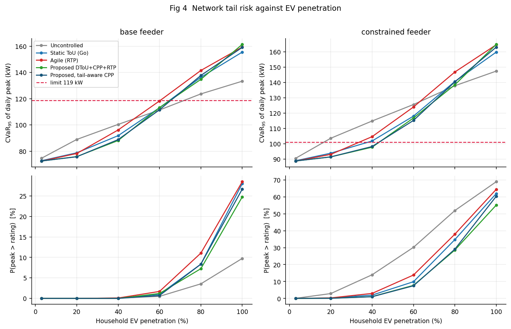

# Pricing scheme choice and the tail risk of EV charging on a London LV feeder

Laidlaw Scholarship research project.

**Research question.** How does the choice of electricity pricing scheme affect both the central tendency and the tail risk of aggregate EV charging demand on a representative London low-voltage feeder, and what is the trade-off between network risk reduction and economic cost and predictability for consumers and operators?

**Short answer.** Pricing scheme choice barely moves the mean but moves the tail a lot. Across the schemes tested, mean feeder peak varies by about 12% while the probability of exceeding the feeder rating varies by a factor of four. A demand-responsive day-ahead tariff (adapted from Khan & Aziz, 2022), iterated to a fixed point before publication, is the only scheme tested that cuts tail risk and consumer cost at the same time. Octopus Agile is cheaper on average, but it carries a fatter tail.



## Method

| Step | What it does | Code |
|---|---|---|
| 0 | Fit London private-BEV input distributions: daily mileage (DfT NTS), initial SOC and plug-in time (heuristic estimates) | `fit_mileage.py`, `plot_start_time.py`, `plot_initial_soc.py` |
| 1 | Monte Carlo London-wide EV charging load (Wei et al., 2026) | `ev_load_monte_carlo.py` |
| 2 | Day-ahead DToU + CPP + RTP tariff on a 75-household LV feeder (Khan & Aziz, 2022, adapted) | `feeder_model.py`, `pricing.py`, `day_ahead_tariff.py` |
| 3 | Compare five schemes over 2,000 Monte Carlo days, 6 penetrations and 2 network cases; efficient frontier, CVaR-constrained optimisation, 365-day backtest | `run_experiments.py`, `analysis.py`, `figures.py` |

The schemes compared are uncontrolled charging (Ofgem cap), static ToU (Octopus Go), Octopus Agile, the proposed DToU + CPP + RTP, and a tail-aware variant of it.

There's a full derivation of every equation in [`docs/METHODOLOGY.md`](docs/METHODOLOGY.md). Results and conclusions are in [`docs/ANALYSIS.md`](docs/ANALYSIS.md).

## Repository layout

```
├── data
│   ├── raw/            DfT NTS0901a, NTS0904; DESNZ subnational electricity statistics
│   └── processed/      fitted distributions and the step-1 London load profile
├── docs
│   ├── METHODOLOGY.md  equations and adaptations
│   ├── ANALYSIS.md     results and conclusions
│   └── inputs/         derivations of the heuristic SOC and start-time estimates
├── figures/            all figures (inputs/ holds the step-0 plots)
├── results/            metric tables, frontier, policy grid, backtest
└── src/
```

## Running

Requires Python 3.10 or newer.

```bash
pip install -r requirements.txt

python src/fit_mileage.py          # step 0, a few seconds
python src/plot_start_time.py
python src/plot_initial_soc.py
python src/ev_load_monte_carlo.py  # step 1, a few minutes
python src/day_ahead_tariff.py     # step 2, a single worked day
python src/figures.py              # step 3, full pipeline and every figure (long run)
```

`run_experiments.py` and `analysis.py` can also be run on their own. Every run is seeded, so the outputs in `results/` and `figures/` are reproducible.

## Known limitations

These are covered in `docs/METHODOLOGY.md` §9 and `docs/ANALYSIS.md` §9.

- The DToU level coefficient `C1` is a factor of Δt too low on the half-hourly grid. This changes the proposed scheme's consumer cost. It doesn't change any network-risk metric.
- The RTP recursion (Khan & Aziz eqs. 12–13) is unbounded. It is clipped at zero here, but it has no cap or reconciliation.
- Agile prices come from Octopus's published algorithm applied to a modelled wholesale process. They aren't historical Agile data.
- The initial-SOC and plug-in-time distributions are heuristic estimates, not fits to London telemetry.
- A fresh run reproduces `backtest_*.csv`, `cvar_policy_grid.csv` and `day_ahead_tariff.csv` exactly. It does not reproduce `metrics_by_scheme.csv` exactly: scheme rankings hold, but individual metrics shift by Monte Carlo noise, and the break-even shadow price (`breakeven_shadow_price.csv`, Fig 9) is sensitive to this. The step-1 load profile shipped here also comes from a slightly earlier version of the step-1 script, and differs from a fresh run by at most 0.5 MW.

## References

- K. Wei et al., "Empirical analysis of electric vehicle charging load forecasting based on Monte Carlo simulation model", *Global Energy Interconnection* 9 (2026) 131–142. [doi:10.1016/j.gloei.2025.12.003](https://doi.org/10.1016/j.gloei.2025.12.003)
- T. A. Khan and T. Aziz, "Developing a Day-Ahead Dynamic Pricing Scheme for Charging Electric Vehicles in Bangladesh", GECOST 2022. [doi:10.1109/GECOST55694.2022.10010568](https://doi.org/10.1109/GECOST55694.2022.10010568)

## Data sources

- DfT National Travel Survey tables NTS0901a and NTS0904 (England, 2024)
- DESNZ, *Subnational electricity consumption statistics 2005–2024*
- TfL Technical Note 12; GLA "Car Emissions" (London BEV share)
- DfT EV driver survey
- SP Energy Networks ESDD-02-012 (LV feeder design)
- UK Power Networks LPN LC14 Use of System Charging Statement (2026 DUoS)
- Ofgem energy price cap (Jul–Sep 2026); Octopus Go and Agile tariff structures
- Ofgem / London Economics, *The Value of Lost Load for Electricity in GB* (2013)

The UK government datasets are published under the Open Government Licence v3.0.
