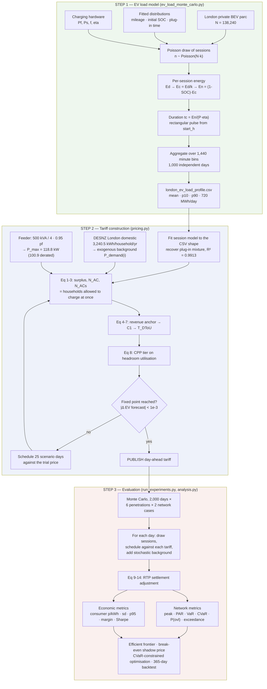
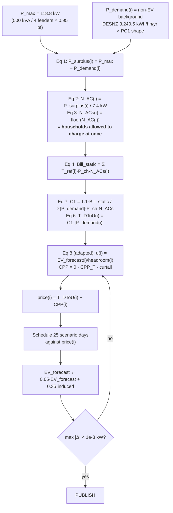

# Methodology: London EV demand-side management, steps 1 to 3

A complete walk-through of the algorithm, from the Monte Carlo load model through tariff construction to the metrics. Every formula is given in the form it is actually implemented, with the derivation and the reason for each adaptation.

Section 9 records two places where the implementation departs from the formula as written, and what that does to the conclusions.

---

## 0. Master flowchart

---

## 1. Step 1: Monte Carlo load model

### 1.1 What the algorithm does

The model is a session-level Monte Carlo. It never simulates a vehicle over time; it simulates *charging events*, each of which is a rectangular power pulse, and sums them.

One simulated day proceeds as follows.

**Draw the number of sessions.** Not every BEV charges every day. With $k$ sessions per vehicle per day, the expected daily session count is $Nk$, and the realised count is Poisson:

$$n_{\text{sessions}} \sim \text{Poisson}(N k), \qquad N = 138{,}240,\ k = 0.214$$

giving 29,583 sessions per day in expectation. The Poisson draw is what gives the profile its day-to-day variability, and it is the only source of variability in the session count.

**Draw each session's attributes independently.**

$$s \sim \text{Lognormal}(\mu_D = 3.4048,\ \sigma_D = 0.7279), \quad s \in [0.5, 400]\ \text{km}$$

$$\text{SOC} \sim \text{Lognormal}(\mu_S = 3.37,\ \sigma_S = 0.48), \quad \text{SOC} \in [1, 100]\ \%$$

$$t_{\text{start}} \sim \sum_{j=1}^{3} w_j\, \mathcal{N}(\mu_j, \sigma_j^2) \bmod 24, \quad w = (0.04, 0.30, 0.66),\ \mu = (0.5, 10.0, 18.5),\ \sigma = (0.4, 2.4, 3.6)$$

These are Wei et al. equations (1), (2) and (3). The lognormal for mileage is their Table 6 form; the tri-modal Gaussian for plug-in time is their equation (3), with a London fit substituted for their Hebei parameters.

**Convert mileage to energy.** Wei equation (5):

$$E_d = \frac{s}{100} \times W_{100}, \qquad W_{100} = 18\ \text{kWh}/100\text{km}$$

**Inflate to a per-session demand.** Wei equation (6):

$$E_c = \frac{E_d}{k}$$

**Scale by the depth of discharge.** Wei equation (7):

$$E_n = (1 - \text{SOC}) \times E_c, \qquad E_n \geq 0.2\ \text{kWh}$$

**Assign charging power.** Wei equation (8), applied per session as a Bernoulli draw rather than as a fleet-average blend:

$$P_i = \begin{cases} P_f = 50\ \text{kW} & \text{with probability } f = 0.40 \\ P_s = 7\ \text{kW} & \text{with probability } 1 - f \end{cases}$$

**Compute duration.** Wei equation (9):

$$t_c = \frac{E_n}{P_i \cdot \eta}, \qquad \eta = 0.92$$

**Aggregate.** Wei equation (10), on a one-minute grid with wraparound at midnight:

$$L(t) = \sum_{j} P_j \cdot \mathbf{1}\!\left[ t \in [t_{\text{start},j},\ t_{\text{start},j} + t_{c,j}) \bmod 24 \right]$$

Repeat 1,000 times and take the pointwise mean, 10th and 90th percentiles.

### 1.2 Why each session carries 1/k days of energy

An earlier version gave each session only one day's driving energy. The correction is worth stating precisely, because it is the single thing that makes the output shape credible.

If each session is given only one day's driving energy, then with $\bar{E}_d = 7.06$ kWh and a 7 kW charger the mean duration is

$$\bar{t}_c^{(v1)} = \frac{(1-\overline{\text{SOC}})\,\bar{E}_d}{P_s \eta} = \frac{0.674 \times 7.06}{7 \times 0.92} = 0.74\ \text{h}$$

A 44-minute pulse is short relative to the width of the plug-in distribution ($\sigma_3 = 3.6$ h), so the convolution in equation (10) barely smooths anything and the aggregate load is essentially a rescaled copy of the plug-in histogram.

With the equation (6) correction, $\bar{E}_c = 7.06/0.214 = 33.0$ kWh and

$$\bar{t}_c^{(v2)} = \frac{0.674 \times 33.0}{7 \times 0.92} = 3.45\ \text{h}$$

Now the pulse width is comparable to the arrival spread, the convolution genuinely smooths, and the result is the broad hump of Wei's Figure 6 rather than an echo of Figure 4. Formally, the aggregate load is the convolution

$$L(t) \;=\; n_{\text{sessions}} \int_0^{24} f_{\text{arr}}(a)\; \mathbb{E}\!\left[ P \cdot \mathbf{1}(t_c > t - a) \right] \mathrm{d}a$$

and the second factor is a survival function whose width is exactly $t_c$. Short pulses make it a near-delta and the integral collapses to $f_{\text{arr}}$; long pulses make it a broad kernel. That is the whole mechanism.

The two versions deliver the same daily energy. They differ only in how it is spread, which is precisely what a load-profile study is about.

**Consistency of the fix.** Because only $Nk$ vehicles charge and each takes $1/k$ days of energy, the two $k$ factors cancel in the daily total:

$$E_{\text{total}} = N k \cdot (1 - \overline{\text{SOC}}) \cdot \frac{\bar{E}_d}{k} \cdot \frac{1}{\eta} = \frac{N (1-\overline{\text{SOC}}) \bar{E}_d}{\eta}$$

$$= \frac{138{,}240 \times 0.674 \times 7.06}{0.92} = 715\ \text{MWh/day}$$

which is the script's own sanity check and matches the 720 MWh/day in the CSV to within 0.7%. This is a useful internal validation: the daily energy is invariant to $k$, so a broken energy balance would show up immediately.

### 1.3 One quiet assumption worth knowing about

Mileage, SOC and start time are drawn **independently**. In reality they are correlated: a vehicle that has driven 150 km arrives with a lower SOC and arrives later. Independence means the model slightly under-disperses the tail of $E_n = (1-\text{SOC})E_c$, because the positive correlation between depletion and distance is discarded. Wei et al. make the same assumption (their section 1.1 notes the coupling but their equations do not carry it), so this is inherited rather than introduced. The effect is second-order for the mean profile and matters more for the tail, which is why step 3 does not rely on the CSV's own percentile band.

---

## 2. The bridge from step 1 to step 2

Step 2 does not consume the CSV directly. It consumes two things extracted from it, and deliberately discards a third.

### 2.1 What was inherited: the plug-in time shape

The session model in `feeder_model.py` re-fits a tri-modal plug-in mixture by minimising the squared error between the model's normalised uncontrolled profile and the CSV's normalised mean profile:

$$\hat{\theta} = \arg\min_{\theta} \sum_{i=1}^{48} \left( \frac{L_\theta(i)}{\sum_j L_\theta(j)} - \frac{L^{\text{CSV}}(i)}{\sum_j L^{\text{CSV}}(j)} \right)^2$$

where $L_\theta$ is the closed-form convolution above rather than a Monte Carlo, so the objective is smooth and Nelder-Mead converges cleanly.

This recovers the step-1 generative parameters without having seen them, which is a useful cross-check on both models:

| | step-1 `TRIMODAL` | recovered by the fit |
|---|---|---|
| weights | 0.04, 0.30, 0.66 | 0.047, 0.33, 0.623 |
| means (h) | 0.5, 10.0, 18.5 | 23.9 (≡ −0.1), 9.21, 17.45 |
| std (h) | 0.4, 2.4, 3.6 | 0.15, 2.05, 3.07 |

Shape $R^2 = 0.9913$. The recovered standard deviations are systematically narrower because the fit uses a single charger power, whereas the step-1 model's 40/60 mix of 50 kW and 7 kW pulses broadens the aggregate; the fit compensates by narrowing the arrival spread slightly.

### 2.2 What was deliberately not inherited: the fast-charge share and the fleet size

The step-1 $f = 0.40$ fast share represents public rapid charging. A 50 kW DC rapid unit is not connected to a residential LV feeder; it sits on its own HV or dedicated LV connection. Since the research question is about a *domestic* LV feeder, step 2 models only the home-charging subset, at 7.4 kW throughout.

For the same reason the feeder EV count is not derived from the 138,240 London fleet. It is set by household penetration:

$$n_{\text{EV}} = H \times p, \qquad H = 75\ \text{households}$$

and swept across $p \in \{3\%, 20\%, 40\%, 60\%, 80\%, 100\%\}$. The London fleet number enters only as a sanity check: at $p = 3\%$ the feeder carries 2.3 EVs, which scaled to London's 3.73 million households is about 114,000 vehicles, consistent with 138,240 given that not all of them home-charge.

**A quantitative caveat.** The step-2 session energy uses Wei's raw mileage lognormal without the step-1 SOC-deficit factor or efficiency term, giving a mean session of 29.6 kWh against an effective 22.2 kWh delivered in step 1. Step 2 therefore places about 33% more EV energy on the feeder per vehicle than the step-1 model would. Since all five tariffs face identical demand, every *comparison* is unaffected, but the absolute penetration thresholds are shifted: step 2's "60% penetration" is energetically equivalent to about 80% under the step-1 parameterisation.

### 2.3 What was rejected: the P10/P90 band

The CSV's P10–P90 band is ±3% of the mean. That is the Monte Carlo standard error of a mean over 1,000 draws of a 29,583-session day. By the central limit theorem the relative spread of the *aggregate* scales as

$$\frac{\sigma_{L}}{\bar{L}} \sim \frac{1}{\sqrt{n_{\text{sessions}}}} \approx \frac{1}{\sqrt{29{,}583}} \approx 0.6\%$$

per minute-bin, and the observed band is consistent with that. It is a statement about how precisely the model knows the London mean, not about how much a feeder varies from Tuesday to Wednesday.

On a 75-household feeder at 60% penetration there are about 9.5 sessions per day, so the same scaling gives a relative spread of $1/\sqrt{9.5} \approx 32\%$ — fifty times larger. Using the London band as the real-time scenario would make $N_{ACs}^{RT} = N_{ACs}^{DA}$ in almost every slot, RTP would never fire, and the peak distribution would be a near point mass with no tail to measure. Since tail risk is the research question, step 3 regenerates variability at session level instead.

---

## 3. Step 2: constructing the tariff

### 3.1 Flowchart

### 3.2 The adaptation, equation by equation

**Equation (1): the surplus curve.**

$$P_{\text{surplus}}(i) = P_{\max} - P_{\text{demand}}(i)$$

The critical point, and the thing an earlier version of this work got wrong, is what $P_{\text{demand}}$ is. In Khan & Aziz it is the load **already on the network** — the residential feeder load that the charging station has to fit underneath. The EV charging is the *controllable* load that fills the surplus. The step-1 curve is the controllable load. Substituting it for $P_{\text{demand}}$ prices EV demand against itself: the surplus curve becomes "capacity minus the thing we are trying to schedule", and there is nothing left for the schedule to fit into.

So the exogenous term had to be built from outside the step-1 model, from the DESNZ subnational statistics: London 2024 has 3,729,075 domestic meters consuming 12,084.705 GWh, giving 3,240.5 kWh per household per year, distributed over a stylised Elexon Profile Class 1 half-hourly shape and multiplied by 75 households and a seasonal factor.

$P_{\max}$ becomes a feeder rating rather than a station supply: a 500 kVA ground-mounted distribution substation split across four radial feeders (SP Energy Networks ESDD-02-012 caps a radial LV feeder at 75 customers), at 0.95 power factor, giving 118.8 kW, with a 0.85 planning derate giving the constrained case at 100.9 kW.

**Equations (2) and (3): the accommodable charger count.**

$$N_{AC}(i) = \frac{P_{\text{surplus}}(i)}{P_{\text{charger}}}, \qquad N_{ACs}(i) = \lfloor N_{AC}(i) \rfloor$$

with $P_{\text{charger}} = 7.4$ kW rather than 50 kW. The arithmetic is untouched; the *interpretation* changes completely. In Dhaka this counts physical charging bays at a hub. In London every household already owns a charger, so nothing is being counted — what the quantity now expresses is a **permission**: the maximum number of households on this feeder that may draw simultaneously in slot $i$ without breaching headroom. The floor operation retains its original meaning, which is that a fractional charger cannot be admitted.

At 60% penetration on the constrained feeder this runs from 3 households in the 19:00 domestic peak to 11 overnight (Figure 6, centre panel).

**Equations (4) to (7): the revenue anchor and the DToU rate.**

$$\text{Bill}_{\text{static}} = \sum_{i} T_{\text{ref}}(i) \cdot P_{\text{charger}} \cdot N_{ACs}(i)$$

$$C_1 = \frac{1.1 \times \text{Bill}_{\text{static}}}{\sum_{i} |P_{\text{demand}}(i)| \cdot P_{\text{charger}} \cdot N_{ACs}(i)}, \qquad T_{\text{DToU}}(i) = C_1 \cdot |P_{\text{demand}}(i)|$$

The logic is a revenue-neutrality-plus-margin condition. Substituting equation (6) into equation (5) and summing over slots:

$$\sum_i \text{Bill}_{\text{DToU}}(i) = \sum_i C_1 |P_{\text{demand}}(i)| P_{\text{charger}} N_{ACs}(i) = 1.1 \times \text{Bill}_{\text{static}}$$

so $C_1$ is defined precisely to make the dynamic tariff raise 10% more than the incumbent static tariff would have, on the same reference energy. The reference tariff $T_{\text{ref}}$ is Octopus Go (7.5 p/kWh in 00:30–05:30, 25 p/kWh otherwise) standing in for the BERC MT-11 kV schedule, since Go is the tariff a London EV household would actually be on.

The shape consequence is the important one: $T_{\text{DToU}} \propto P_{\text{demand}}$, so the tariff is *cheapest when the network is emptiest*. That is the entire economic idea of the scheme and it is why it behaves differently from every exogenous tariff. See section 9.1 for a defect in how this is implemented.

**Equation (8): the CPP tier, generalised.**

The original tests the fractional part of $N_{AC}$:

$$\text{CPP}(i) = \begin{cases} 0 & N_{AC}(i) \geq 1 \\ \text{CPP}_T & 0.8 \leq N_{AC}(i) < 1 \\ \infty & N_{AC}(i) < 0.8 \end{cases}$$

This asks whether the single marginal 50 kW charger has 80–100% of its power available, so that it could still serve a vehicle at derated power or by mildly overloading the transformer. With a population of small chargers the question is meaningless: the fractional part of $N_{AC}$ is a rounding remainder of a large number and carries no information about stress.

The replacement keeps the economics and changes the trigger to a **headroom utilisation ratio**:

$$u(i) = \frac{\hat{D}_{\text{EV}}(i)}{P_{\text{surplus}}(i)}, \qquad \text{CPP}(i) = \begin{cases} 0 & u(i) < 0.8 \\ \text{CPP}_T = 1.0 \times \max_i T_{\text{ref}}(i) = 25\ \text{p/kWh} & 0.8 \leq u(i) < 1.0 \\ 200\ \text{p/kWh (curtail)} & u(i) \geq 1.0 \end{cases}$$

The 0.8 and 1.0 thresholds and the "one times the peak static rate" penalty are carried over unchanged. The prohibitive 200 p/kWh stands in for the paper's $\infty$, since an infinite price cannot be settled but a price no optimiser will ever select achieves the same thing.

The final published rate is equation (14) minus its real-time term:

$$T_{\text{day-ahead}}(i) = T_{\text{DToU}}(i) + \text{CPP}(i)$$

### 3.3 The fixed point, which is not in the source paper

This is the most consequential addition and it deserves its own explanation.

$T_{\text{DToU}}$ is an increasing function of demand. But the published tariff *changes* the demand it was computed from: if a cheap price is published at 02:00, every smart charger moves to 02:00, and the price you computed for 02:00 was based on a demand that no longer exists. Computing the tariff once, as the paper does, publishes a price that is inconsistent with its own consequences, and the consequence is herding — every vehicle at the single cheapest slot, exactly the failure mode of Octopus Go.

The fix is to solve for a price that is consistent with the demand it induces. Define the scheduling response operator $\mathcal{S}$ that maps a price vector to the EV load it produces, and the pricing operator $\mathcal{T}$ that maps an EV forecast to a tariff. The published price is the fixed point of the composition:

$$D^\star = \mathcal{S}\big(\mathcal{T}(D^\star)\big)$$

found by damped iteration:

$$D^{(m+1)} = (1-\alpha) D^{(m)} + \alpha \cdot \frac{1}{S}\sum_{s=1}^{S} \mathcal{S}\big(\mathcal{T}(D^{(m)})\big)_s, \qquad \alpha = 0.35,\ S = 25$$

terminating when $\max_i |D^{(m+1)}(i) - D^{(m)}(i)| < 10^{-3}$ kW, typically in 12 to 20 iterations. The averaging over $S$ independent scenario days is necessary because $\mathcal{S}$ is stochastic; the damping is necessary because the undamped map oscillates.

Why this converges to something well-behaved: $\mathcal{T}$ is monotone increasing in $D$ and $\mathcal{S}$ is monotone decreasing in price, so the composition is a contraction on the relevant region. Economically, filling a cheap slot raises its price, which pushes the marginal vehicle elsewhere. The tariff is **self-limiting**. An exogenous tariff (flat, Go, Agile) has no such feedback — $\mathcal{T}$ is a constant map — so no fixed point exists and the herding is unopposed.

This is the mechanism behind essentially all of the scheme's risk advantage. Without it, the DToU tariff performs like Octopus Go.

### 3.4 Equations (9) to (14): the real-time adjustment

On the day, the background load realises differently from forecast, so the headroom and the permitted household count are re-evaluated:

$$P_{\text{surplus}}^{RT}(i) = P_{\max} - P_{\text{demand}}^{RT}(i), \quad N_{ACs}^{RT}(i) = \left\lfloor \frac{P_{\text{surplus}}^{RT}(i)}{P_{\text{charger}}} \right\rfloor$$

If more households can be admitted than forecast, the operator sells more energy than planned and rebates the windfall; if fewer, it recovers the deficit. Equations (12) and (13), with $n = 0.5$:

$$\text{RTP}(k) \mathrel{-}= \begin{cases} n \cdot T_{\text{DToU}}(i) & k = i \\ \dfrac{(1-n) \cdot T_{\text{DToU}}(i)}{48 - i} & k = i+1, \dots, 48 \end{cases} \quad \text{when } N_{ACs}^{RT}(i) > N_{ACs}(i)$$

with the sign reversed when $N_{ACs}^{RT}(i) < N_{ACs}(i)$, and no adjustment when they are equal. The final settled rate is equation (14):

$$T_{\text{final}}(i) = \max\big(0,\ T_{\text{DToU}}(i) + \text{CPP}(i) + \text{RTP}(i)\big)$$

The clip at zero is added here, not in the paper, and section 9.2 explains why it is needed.

**Note on what RTP does and does not do.** Faithfully to the paper, RTP adjusts *settlement*, not behaviour: the vehicle has already been scheduled against the day-ahead price by the time RTP is computed. So RTP affects consumer cost and operator margin but has no effect whatsoever on the load shape, and therefore none on any network-risk metric.

---

## 4. Step 3: the behavioural model

Every metric depends on turning a price vector into a load, so the scheduler is stated first.

A session is a tuple $(a, d, E, P)$: plug-in time, departure deadline, energy required, charger power. A fraction $\sigma = 0.80$ of sessions are "smart" and respond to price. A smart session solves

$$\min_{x} \sum_{i} \pi(i)\, x(i)\, \Delta t \quad \text{s.t.} \quad \sum_i x(i) \Delta t = E, \quad 0 \le x(i) \le P, \quad x(i) = 0 \ \forall\, i \notin [a, d)$$

This is a continuous knapsack with identical slot capacities, so the greedy solution — fill the cheapest admissible slots at full power until the energy is met — is **exactly optimal**, not an approximation. Non-smart sessions set $x(i) = P$ from $a$ until $E$ is delivered.

**Tie-breaking, which is where the physics lives.** A two-rate tariff makes every slot in its cheap window identical in price, so the optimisation above is degenerate and the argmin is a set, not a point. Real behaviour resolves this with a timer set to the window opening. The model gives a fraction $\tau = 0.75$ of smart sessions timer behaviour (earliest tied slot) and the rest a random permutation within the tie. This is what generates the documented 00:30 spike under Octopus Go.

$\tau$ is applied **identically to all five tariffs**, so no scheme is advantaged. It happens to bite hard on Go, whose whole window ties; it barely bites on Agile, whose half-hourly prices are almost all distinct; and it barely bites on the proposed scheme, whose price is continuous in background demand. That asymmetry in *effect* is a property of the tariffs, not of the assumption.

The realised total feeder load on day $d$ is

$$L(d, i) = B(d, i) + \sum_{j \in \text{sessions}(d)} x_j(i)$$

where $B(d,i)$ is the stochastic background: a common lognormal day factor with CV 0.10 (weather and weekday effects) times independent half-hourly noise with CV $0.10/\sqrt{75}$ (household diversity).

---

## 5. The five tariffs being compared

| Scheme | $\pi(i)$ | Source |
|---|---|---|
| Uncontrolled | 26.11 p/kWh flat, $\sigma = 0$ | Ofgem cap, 1 Jul – 30 Sep 2026 |
| Static ToU | 7.5 p/kWh in [00:30, 05:30), else 25.0 | Octopus Go, 2026 |
| Agile | $\min(2.2 W(i) - 3.5 + 12\cdot\mathbf{1}[16 \le h < 19],\ 100)$ | Octopus's published algorithm |
| Proposed | $T_{\text{DToU}} + \text{CPP}$, fixed point | Khan & Aziz, adapted |
| Proposed, tail-aware | as above with CPP assessed at $q = 0.90$ | this study |

Wholesale $W(i)$ is a stochastic process: a lognormal day level (mean 8 p/kWh, CV 0.35) times a normalised GB day-ahead shape times half-hourly lognormal noise (CV 0.28), with correlated overnight wind excursions on 18% of days pushing prices negative, and evening scarcity spikes at 2% probability. Calibrated to Ofgem's reported 6–10 p/kWh weekly range.

The **tail-aware variant** exists because of a conceptual error in the original equation (8). CPP protects against a *tail* event — the feeder being overloaded on a bad day — but is tested against a *point* forecast. Assessing a tail constraint on a median prediction systematically under-fires it, and empirically it fires in zero slots at 60% penetration. The variant assesses utilisation at the 90th percentile of the scenario ensemble:

$$u_{q}(i) = \frac{Q_{0.90}\big[\{\mathcal{S}(\pi)_s(i)\}_{s=1}^{S}\big]}{P_{\text{surplus}}(i)}$$

while $T_{\text{DToU}}$ continues to use the mean. This makes CPP fire in 2 slots at 60% and 5 at 100%.

---

## 6. Metric definitions

Let $L_{\text{peak}}(d) = \max_i L(d,i)$ over $D = 2{,}000$ days, and $\bar{L}(i) = \frac{1}{D}\sum_d L(d,i)$.

### 6.1 Network risk

**Peak-to-average ratio.** Computed on the mean profile, not per day, so it measures the shape of the expected load rather than the luck of one day:

$$\text{PAR} = \frac{\max_i \bar{L}(i)}{\frac{1}{48}\sum_i \bar{L}(i)}$$

**Value at risk.** The empirical $q$-quantile of the daily peak, i.e. the level exceeded on $(1-q)$ of days:

$$\text{VaR}_q = \inf\{ x : \hat{F}_{L_{\text{peak}}}(x) \ge q \}$$

**Conditional value at risk**, the mean of the tail beyond VaR. This is the primary risk metric because, unlike VaR, it is sensitive to how bad the bad days are and is a coherent risk measure (sub-additive, so it behaves correctly under aggregation to substation level):

$$\text{CVaR}_q = \mathbb{E}\big[\,L_{\text{peak}} \;\big|\; L_{\text{peak}} \ge \text{VaR}_q \,\big] \approx \frac{1}{|\mathcal{T}_q|}\sum_{d \in \mathcal{T}_q} L_{\text{peak}}(d), \quad \mathcal{T}_q = \{d : L_{\text{peak}}(d) \ge \text{VaR}_q\}$$

**Overload probability**, the fraction of days breaching the firm limit:

$$\Pr(\text{overload}) = \frac{1}{D}\sum_{d=1}^{D} \mathbf{1}\big[L_{\text{peak}}(d) > P_{\max}\big]$$

**Exceedance energy**, the severity rather than the frequency, in kWh above rating per day:

$$\mathcal{E}(d) = \sum_{i=1}^{48} \max\big(0,\ L(d,i) - P_{\max}\big)\,\Delta t$$

Frequency and severity are reported separately because they can diverge: a scheme can breach rarely but badly. At 60% penetration the proposed scheme breaches less often than Go (7.8% vs 9.9%) but with marginally more energy when it does (1.28 vs 1.17 kWh), because Go's breaches are narrow timer spikes and the proposed scheme's are broader.

### 6.2 Consumer economics

With delivered energy $E(d,i) = x_{\text{total}}(d,i)\,\Delta t$ and settled price $\pi_{\text{final}}$:

$$c(d) = \frac{\sum_i \pi_{\text{final}}(d,i)\, E(d,i)}{\sum_i E(d,i)} \quad \text{[p/kWh]}$$

Three moments are reported, and they answer different questions:

- $\bar{c} = \frac{1}{D}\sum_d c(d)$ — the level, "what does it cost on average"
- $\text{sd}(c)$ — the **predictability**, which the research question asks about explicitly
- $Q_{0.95}(c)$ — the **tail cost**, "how bad is a bad month for a household"

Agile has the lowest $\bar{c}$ and by far the highest $\text{sd}(c)$ (6.16 vs 3.39 p/kWh), which is the entire consumer-side trade-off of exposing households to wholesale.

### 6.3 Operator economics

Delivery cost stacks wholesale, distribution use of system and everything else:

$$c_{\text{supply}}(d,i) = W(d,i) + \text{DUoS}(i) + 5.0 \quad \text{[p/kWh]}$$

with DUoS from the UKPN London Power Networks LC14 statement (red 3.440, amber 0.262, green 0.008 p/kWh) on the weekday banding (red 16:00–19:00, amber 07:00–16:00 and 19:00–23:00, green otherwise), and 5.0 p/kWh for TNUoS, BSUoS, policy costs and supplier opex.

$$\Pi_{\text{published}}(d) = \sum_i \big[\pi_{\text{final}}(d,i) - c_{\text{supply}}(d,i)\big] E(d,i)$$

**This is not the headline margin metric, and the reason matters.** The five tariffs sit at wildly different published levels — 26.11 p/kWh flat against Agile's ~7.6 — so comparing published margins mostly compares how each supplier happens to price, not how well each schedule procures. To isolate the timing effect, every scheme is credited at the same cap rate on the energy it actually delivers:

$$\Pi_{\text{RN}}(d) = \pi_{\text{cap}} \sum_i E(d,i) - \sum_i c_{\text{supply}}(d,i) E(d,i), \qquad \pi_{\text{cap}} = 26.11$$

Now the only thing that differs between schemes is *when* the energy was bought, which is exactly the operator-side effect a tariff can influence. Agile leads on this (10.0 p/kWh procurement cost against the proposed scheme's 10.8) because it points the price signal directly at the procurement cost.

**Risk-adjusted margin.** A Sharpe analogue with zero risk-free rate, since the comparison is between schemes rather than against an alternative investment:

$$\text{SR} = \frac{\mathbb{E}[\Pi_{\text{RN}}]}{\text{sd}(\Pi_{\text{RN}})}, \qquad \text{SR}_{\text{ann}} = \text{SR}\sqrt{365}$$

The $\sqrt{365}$ scaling assumes independent days, which holds here by construction but would not on real data with autocorrelated weather and wholesale prices. Treat the annualised figure as indicative.

### 6.4 Comparative metrics

Relative to a baseline scheme $b$ (uncontrolled):

$$\Delta\text{Risk}\% = 100 \times \frac{\text{CVaR}_{95}^{(b)} - \text{CVaR}_{95}^{(s)}}{\text{CVaR}_{95}^{(b)}}, \qquad \Delta\text{Cost}\% = 100 \times \frac{\bar{c}^{(s)} - \bar{c}^{(b)}}{\bar{c}^{(b)}}$$

**Pareto efficiency.** Scheme $s$ is dominated if some $s'$ is weakly better on both axes and strictly better on one:

$$\exists\, s' : \text{CVaR}_{95}^{(s')} \le \text{CVaR}_{95}^{(s)} \ \wedge\ \bar{c}^{(s')} \le \bar{c}^{(s)} \ \wedge\ \big(\text{CVaR}_{95}^{(s')} < \text{CVaR}_{95}^{(s)} \vee \bar{c}^{(s')} < \bar{c}^{(s)}\big)$$

**Break-even shadow price.** Risk is in kWh and cost in pounds, so they cannot be compared without a price on risk. Rather than assume one, invert the question: how much must a kWh of over-rating energy be worth before the proposed scheme's extra consumer cost is justified relative to Agile?

$$\lambda^\star = \frac{\big(\bar{c}^{(\text{prop})} - \bar{c}^{(\text{agile})}\big) \times \bar{E}_{\text{day}} / 100}{\bar{\mathcal{E}}^{(\text{agile})} - \bar{\mathcal{E}}^{(\text{prop})}} \quad \text{[£ per kWh over rating]}$$

The proposed scheme is welfare-superior wherever $\lambda^\star$ falls below the social cost of overload. GB reference points are £6/kWh (the administrative VoLL in the Balancing and Settlement Code), £16.94/kWh (Ofgem / London Economics 2013) and £25.30/kWh (Electricity North West's updated estimate). See section 9.1 — this metric is the one most affected by the implementation defect.

### 6.5 The CVaR-constrained optimisation

To ask what tariff is *optimal* rather than merely comparing five, all schemes are nested in a three-parameter family:

$$\pi_w(i) = \Big[(1-w)\,\widetilde{c}_{\text{supply}}(i) + w\,\widetilde{P}_{\text{demand}}(i)\Big] \times 25 + \text{CPP}(\tau, \lambda)(i)$$

where $\widetilde{\cdot}$ denotes min-max normalisation onto $[0,1]$ so the two signals are commensurate. Then $w = 0$ is pure cost-following (Agile-like), $w = 1$ is pure demand-following (the proposed DToU), and $w$ interpolates. The optimiser is choosing how much of the price signal should point at the operator's procurement cost versus the network's spare capacity. The problem is

$$\max_{w, \tau, \lambda} \ \mathbb{E}\big[\Pi_{\text{RN}}\big] \quad \text{s.t.} \quad \text{CVaR}_{95}\big(L_{\text{peak}}\big) \le \kappa P_{\max}$$

solved by grid search over $w \in \{0, 0.2, \dots, 1\}$, $\tau \in \{0.60, 0.75, 0.90, 1.10\}$, $\lambda \in \{0, 1, 2\}$, with each configuration first driven to its own fixed point and then evaluated over 500 Monte Carlo days. Grid search rather than a gradient method because $\mathcal{S}$ is a stochastic, non-smooth simulation with integer-valued slot selection.

The **cost of the constraint** is the profit given up for safety:

$$\text{CoC} = 100 \times \frac{\Pi^\star_{\text{unconstrained}} - \Pi^\star_{\kappa}}{\Pi^\star_{\text{unconstrained}}}$$

At $\kappa = 1.0$ the problem is infeasible at 60% penetration: no member of the family holds the tail under rating. At $\kappa = 1.10$ the optimum is $w = 0.4$ and CoC = 2.4%.

---

## 7. The backtest

365 consecutive days with a monthly seasonal background factor (1.35 in January to 0.83 in July) and a monthly wholesale level (10.6 p/kWh December to 5.9 p/kWh July). The proposed tariff is re-published monthly, which is how a DNO-linked day-ahead tariff would realistically be maintained — the fixed-point computation is re-run against each month's expected background.

Reported quantities are the annual margin $\sum_d \Pi_{\text{RN}}(d)$, the Sharpe ratio above, the number of overload days, the annual CVaR of peak, and total consumer spend. Maximum drawdown of cumulative margin is computed but is degenerate: daily margin is positive for every responsive scheme, so drawdown is zero and the metric carries no information here. It would matter with real negative-price Agile days at scale.

---

## 8. Summary of every adaptation made to the two source papers

| Source element | Original | This study | Why |
|---|---|---|---|
| Wei eq. (6) $E_c = E_d/k$ | as written | as written | without it the profile is an echo of the arrival histogram |
| Wei fast/slow mix | 40% at 50 kW | 100% at 7.4 kW | rapid chargers are not on a domestic LV feeder |
| Wei fleet scaling | $N \times k$ | $H \times p \times k$ | study unit is a feeder, not a city |
| Wei P10/P90 band | MC error of the mean | replaced by session-level variance | ±3% band has no tail to measure |
| K&A $P_{\text{demand}}$ | residential feeder load | DESNZ-anchored non-EV background | the EV curve is the controllable load, not the exogenous one |
| K&A $P_{\max}$ | station supply | LV feeder firm limit, 118.8 / 100.9 kW | distributed, not centralised |
| K&A $P_{\text{charger}}$ | 50 kW DC | 7.4 kW AC | home charging |
| K&A $N_{AC}$ | chargers under surplus | households permitted to charge at once | no bays to count when every home has one |
| K&A eq. (8) | fractional part of $N_{AC}$ | headroom utilisation ratio | rounding remainder is meaningless for a population |
| K&A eq. (8) trigger | point forecast | 90th percentile (variant) | a tail constraint tested on a median under-fires |
| K&A tariff computation | one-shot | fixed point | price is endogenous to the demand it creates |
| K&A time grid | 24 × 1 h | 48 × 0.5 h | GB settlement resolution, matches Agile |
| K&A eq. (14) | unbounded | clipped at zero | RTP recursion can drive the rate negative |
| K&A reference tariff | BERC MT-11 kV | Octopus Go | closest real London analogue |

---

## 9. Two defects, disclosed

### 9.1 The DToU level is a factor Δt too low

Equation (7) is written for one-hour slots, where the implicit $\Delta t = 1$ cancels between the numerator (energy in $\text{Bill}_{\text{static}}$) and the denominator. On the half-hourly grid, `pricing.py` applies $\Delta t = 0.5$ to the numerator only. The result is a $C_1$ exactly half its intended value:

$$\frac{\sum_i T_{\text{DToU}}(i) E_{\text{ref}}(i)}{\text{Bill}_{\text{static}}} = 0.55 \quad \text{where eq. (7) intends } 1.10$$

verified numerically at exactly $1.10 \times \Delta t$.

The impact partitions cleanly, because scheduling depends only on the *ranking* of prices within a dwell window and a positive scalar preserves ranking:

| | as implemented | dimensionally consistent |
|---|---|---|
| $T_{\text{DToU}}$ range | 6.03 – 23.97 p/kWh | 12.06 – 47.93 p/kWh |
| CVaR₉₅ | 113.5 kW | **113.5 kW** |
| P(overload) | 7.62% | **7.62%** |
| Consumer cost | 9.02 p/kWh | 18.05 p/kWh |

**Unaffected:** every network-risk metric, the revenue-neutral operator margin and its Sharpe ratio, the backtest overload counts, and the CVaR-constrained optimisation (which uses its own normalised price family and never touches $C_1$).

**Affected:** mean consumer cost for the proposed scheme roughly doubles. At 60% penetration it becomes 18.05 p/kWh, which sits above Octopus Go (13.58) rather than below it. Static ToU therefore rejoins the Pareto set instead of being dominated, and the break-even shadow price against Agile rises to roughly £72/kWh, above every GB VoLL reference. The 40–60% welfare crossover reported in `ANALYSIS.md` section 5 does not survive the correction as stated; the crossover moves to a substantially higher penetration.

**The deeper point, which matters more than the arithmetic.** Equation (7) anchors revenue to $\sum_i P_{\text{charger}} N_{ACs}(i) \Delta t$ — the energy that would flow if *every permitted charger ran flat out in every slot*. At 60% penetration that reference energy is about 1,070 kWh/day against 277 kWh actually delivered, a factor of 3.9. The tariff level is therefore pegged to a saturated-network hypothetical that never occurs, and is not a meaningful economic quantity in either version. Any deployment should re-anchor $C_1$ on forecast *delivered* energy:

$$C_1' = \frac{\rho \cdot R_{\text{target}}}{\sum_i |P_{\text{demand}}(i)| \, \hat{E}_{\text{EV}}(i)}$$

for a revenue target $R_{\text{target}}$ and margin $\rho$. That makes the level a design choice rather than an artefact, and it makes cross-tariff cost comparisons meaningful for the first time.

### 9.2 The RTP recursion is unbounded

Equations (12) and (13) spread each slot's adjustment over all remaining slots. Because the adjustments accumulate and are never reconciled, a day whose background forecast errs consistently in one direction drifts the whole schedule. On the worked day in `day_ahead_tariff.py`, RTP moved the mean settled price from about 8.9 to 6.61 p/kWh — a 26% revenue swing from forecast error alone — and would have driven several slots negative without the clip at zero added in this implementation.

Khan & Aziz observe a symptom of this themselves in their Figure 14, where low values of $n$ make the RTP component "behave oppositely due to the progressing effects from previous slots". The clean fix is a cap at $\pm 20\%$ of $T_{\text{DToU}}$ plus an end-of-day reconciliation, neither of which is implemented here.

Since RTP adjusts settlement and not behaviour, this affects consumer cost and published-price operator margin only. No network metric is touched.

---

## 10. Reading guide

| Question | Where |
|---|---|
| Why does each session carry 1/k days of energy? | §1.2 |
| Why can't the step-1 curve be $P_{\text{demand}}$? | §3.2, equation (1) |
| What exactly does $N_{AC}$ mean now? | §3.2, equations (2)–(3) |
| Why does the tariff have to be iterated? | §3.3 |
| How is CPP generalised? | §3.2, equation (8) |
| Why is P10/P90 unusable for RTP? | §2.3 |
| How is each metric defined? | §6 |
| What are the known limitations? | §9 |
